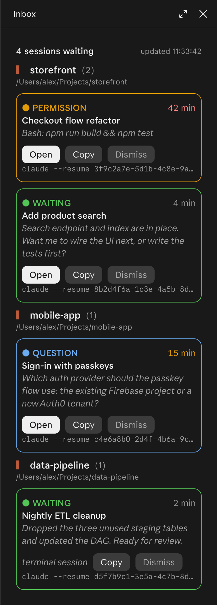

# agent-inbox

**One inbox for every Claude Code session that is waiting on you.**

Run ten agents across five projects and one of them will stop to ask for a permission, pose a question, or finish its turn while you are looking somewhere else. agent-inbox collects those moments from *all* your sessions into a single pane beside the chat, grouped by project, oldest first. Click **Open** to jump straight to the session.



## What it shows

Each card is one session that is waiting on you:

| Badge | Meaning | Where it comes from |
| --- | --- | --- |
| **PERMISSION** | The agent asked to run a tool and is waiting for your approval | `PermissionRequest` / `Notification` hooks |
| **QUESTION** | The agent asked you a question or wants its plan approved | `PreToolUse` on `AskUserQuestion` / `ExitPlanMode` |
| **WAITING** | The agent finished its turn and is idle until you reply | `Stop` hook |

Every card carries the session title, the project folder, a one-line summary (the command awaiting approval, the question, or the agent's last sentence), and how long it has been waiting. Waits over 10 minutes turn amber, over 30 minutes red.

A card disappears as soon as you answer (next prompt, permission decision, question answer) or the session ends. Each session has at most one card.

## Features

- **One install, every project.** The plugin's own hooks run in all your sessions at user scope. Nothing to add per project.
- **Jump to the session.** In Claude Desktop (Code tab) **Open** switches to that session. For terminal sessions the card shows `claude --resume <id>` and **Copy** puts it on your clipboard.
- **Live.** The pane re-reads the inbox file within 1.5 s of any change and refreshes waiting times every 30 s.
- **Safe hooks.** The hook script takes about 100 ms, serialises concurrent writes with a lock, never prints a decision, and always exits 0, so it can never block an agent.
- **Languages.** English, Türkçe, Deutsch, Français, Español. Auto-detected from `LANG` or the macOS system language, or set explicitly.

## Requirements

- Claude Code 2.1.330 or newer (function-hook mods) on macOS or Linux.
- `jq` on the PATH (preinstalled on macOS 15+; `brew install jq` or `apt install jq` otherwise).
- Jumping to a session needs Claude Desktop on macOS; everything else works in the terminal too.

## Install

At the prompt of a terminal Claude Code session:

```
/plugin install agent-inbox --marketplace ktoksoz/agent-inbox
```

Answer `y` to add the marketplace, then pick the **user** scope so the hooks run in every project.

From a shell:

```
claude plugin install agent-inbox --marketplace ktoksoz/agent-inbox --scope user
```

In the Claude desktop app, where `/plugin` does not run: click **+** next to the prompt box, then **Plugins**, **Add marketplace** with `ktoksoz/agent-inbox`, then **Add plugin**.

The hooks are active in that session right away and in every session started afterwards.

## Usage

- In Claude Desktop the pane opens by itself when a session starts (`autoOpen`). Close it with the pane's **×**; `/inbox` brings it back.
- In a terminal session, `/inbox` opens it inline above the prompt (docked beside the transcript in fullscreen mode).
- **Open** switches to the session (Claude Desktop) or copies the resume command (terminal sessions). **Copy** copies `claude --resume <id>`. **Dismiss** removes a card by hand, for example after a session crashed.
- The session the pane is drawn in is listed too, marked *this session*, without an **Open** button; the count is the same in every session.

### Subcommands

| Command | Effect |
| --- | --- |
| `/inbox` | Open (or focus) the pane |
| `/inbox status` | Print the waiting sessions as text, without the pane |
| `/inbox lang <code>` | Switch the language (`en`, `tr`, `de`, `fr`, `es`) and save it to the plugin's options |
| `/inbox clear` | Dismiss every entry |
| `/inbox close` | Close the pane |

## Options

Set them with `/inbox lang <code>` (language only), `/plugin configure agent-inbox`, in `/config`, from a shell with `echo '{"language":"tr"}' | claude plugin configure agent-inbox@agent-inbox --values-stdin`, or at install time with `--config key=value`.

| Option | Default | Meaning |
| --- | --- | --- |
| `language` | `auto` | `auto`, `en`, `tr`, `de`, `fr`, `es`. `auto` reads `LC_ALL`/`LC_MESSAGES`/`LANG`, then the macOS system language, and falls back to English. |
| `autoOpen` | `true` | Open the pane when a Claude Desktop session starts. Terminal sessions never open it unasked. |
| `inboxPath` | `~/.claude/inbox.jsonl` | The file the pane reads and dismisses from. The hook script writes `$CLAUDE_INBOX_FILE` or the default, so to move the file for the hooks too, export `CLAUDE_INBOX_FILE` in the environment Claude Code starts with. |

## How it works

```
 every session ──hooks──▶ scripts/inbox-hook.sh ──▶ ~/.claude/inbox.jsonl ──▶ pane (hooks/register.tsx)
                 Stop, PermissionRequest,        one JSON line per           polls the file, groups by
                 PreToolUse, Notification …      waiting session             project, draws the cards
```

1. `hooks/hooks.json` declares classic command hooks for `Notification`, `PermissionRequest`, `PermissionDenied`, `PreToolUse` (AskUserQuestion, ExitPlanMode), `PostToolUse`, `Stop`, `UserPromptSubmit`, `SessionStart` and `SessionEnd`. They all run `scripts/inbox-hook.sh`.
2. The script reads the hook payload from stdin, decides whether the session is now waiting (and why) or no longer waiting, and rewrites `inbox.jsonl` under a `mkdir` lock (it prints nothing and returns no decision to Claude Code, so it never allows, denies or alters anything): the session's old line is dropped, the new one appended, and lines of sessions whose process is gone are pruned. A Claude Desktop session is recognised by `CLAUDE_CODE_HOST_SESSION_ID`, which becomes the card's deep link; the session title comes from `~/.claude/sessions/<pid>.json`.
3. `hooks/register.tsx` is a Claude Code function-hooks module. It registers `/inbox`, opens the pane, polls the file every 1.5 s with `$.fs.stat`, keeps the parsed entries in `$.state`, and draws the cards from them. **Open** runs `open claude://…` through `$.process.run`.

### Inbox file format

One JSON object per line:

```json
{"session_id":"3f9c…","host_session_id":"local_9a1c…","cwd":"/Users/alex/Projects/storefront",
 "project":"storefront","title":"Checkout flow refactor","kind":"permission",
 "summary":"Bash: npm run build && npm test","tool":"Bash","ts_ms":1795600000000,
 "ts":"2026-11-25T08:26:40Z","entrypoint":"claude-desktop","pid":12345,
 "link":"claude://claude.ai/epitaxy/local_9a1c…"}
```

`kind` is `permission`, `question` or `idle`. `host_session_id` and `link` are empty for terminal sessions. Other tools can read the file too; it is plain JSONL.

## Privacy and safety

- Everything stays on your machine. The plugin makes no network requests and sends nothing anywhere; it has no telemetry.
- What it writes: one line per waiting session in `~/.claude/inbox.jsonl` with the session id, the project folder, the session title, the kind of wait, a short summary (the command awaiting approval, the question, or the first 220 characters of the agent's last message) and a timestamp. That file is readable by any program running as your user, like the rest of `~/.claude`.
- Nothing in the file is trusted: ids are checked to be plain tokens and a link is accepted only if it is exactly a Claude Desktop session link (`claude://claude.ai/epitaxy/local_…`), so a hand-edited line cannot make the pane open another URL or run a command with an odd argument.
- The hook script never touches Claude's permissions or settings. The only option it writes is the plugin's own `language`, when you run `/inbox lang`.
- The debug log (while `~/.claude/inbox.debug` exists) records only event metadata (event name, session id, tool name, notification type, folder) to `~/.claude/inbox-debug.log`, never message text, and is truncated past 1 MB. Files the script creates are mode 0600.

## Limitations

- Switching to a session works for Claude Desktop (Code tab) sessions on macOS, through the app's `claude://claude.ai/epitaxy/<id>` link. That link is not documented by Anthropic and may change with an app update; if it stops working, **Open** falls back to copying the resume command. Terminal sessions cannot be focused from the pane; their resume command is shown and copied instead.
- Chats outside the Code tab (the regular Claude chat, claude.ai) run no hooks and never appear.
- Sessions started before the plugin was installed only pick the hooks up at their next start.
- In Claude Desktop the pane needs the session to attach its page; a session hosted headlessly (`claude -p`, the SDK) records to the file but draws nothing.

## Uninstall

```
claude plugin uninstall agent-inbox@agent-inbox
```

Then delete `~/.claude/inbox.jsonl` if you like. Besides that file (and its transient `.tmp.*` and `.lock/` siblings while a hook runs), the plugin writes only `~/.claude/inbox-debug.log` when you opt in, and the `agent-inbox.language` option in `~/.claude/settings.json` when you run `/inbox lang`.

## Development

```
git clone https://github.com/ktoksoz/agent-inbox
claude --plugin-dir ./agent-inbox     # load it for one session, hot-reloading on save
claude plugin validate ./agent-inbox  # manifest, hooks and types
claude plugin test ./agent-inbox      # the pane tests in tests/
```

Exercise the hook script alone by piping a hook payload into `scripts/inbox-hook.sh`, or run `scripts/inbox-hook.sh --remove <session_id>`. Create `~/.claude/inbox.debug` to log the metadata of every event it receives to `~/.claude/inbox-debug.log`. `docs/demo-inbox.jsonl` is a sample inbox with fictional sessions; point `inboxPath` at it to see a populated pane.

Translations live in `hooks/i18n.ts`; a new language is one more entry in the table.

## License

MIT
